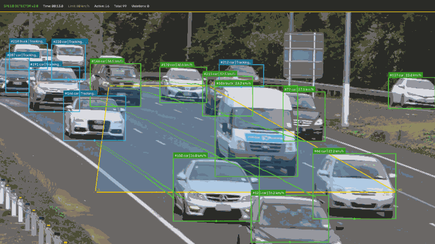
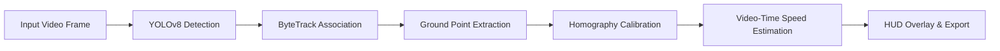
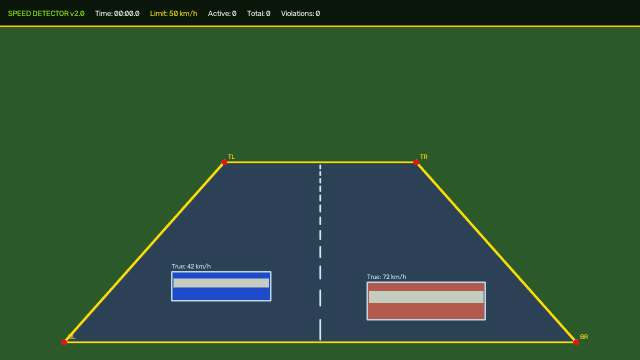

# Vehicle Speed Detection using YOLOv8 & ByteTrack

[](https://www.python.org/)
[-brightgreen.svg)](https://github.com/ultralytics/ultralytics)
[](https://github.com/ifzhang/ByteTrack)
[](LICENSE)

A real-time computer vision pipeline for vehicle detection, multi-object tracking, and speed estimation using **YOLOv8**, **ByteTrack**, and **Top-Down Perspective Homography Calibration**.



---

## Key Features

- **Ultralytics YOLOv8**: Real-time vehicle detection (cars, motorcycles, buses, trucks) with high inference speed.
- **ByteTrack Multi-Object Tracking**: Stable, persistent vehicle IDs across frames, even through partial occlusions.
- **Top-Down Perspective Homography (`cv2.getPerspectiveTransform`)**: Projects camera perspective coordinates onto a real-world metric ground plane (meters), reducing perspective distortion.
- **Video-Time Calculation (`frame_index / fps`)**: Deterministic calculations immune to CPU throttling, frame drops, or hardware lag (no wall-clock `time.time()` bias).
- **Temporal Sliding Window & EMA Smoothing**: Evaluates displacement over a 0.25–0.75s window with exponential moving average to filter out bounding-box jitter.
- **Production CLI (`argparse`)**: Supports local videos, webcams, headless cloud servers/Colab, custom config files, and video exporting.
- **Overspeed Violation Alerts**: Visual and logged warnings when vehicles exceed the speed limit.

---

## Architecture Pipeline



1. **Detect**: YOLOv8 infers bounding boxes and class probabilities for vehicles (`car`, `motorcycle`, `bus`, `truck`).
2. **Track**: ByteTrack matches detections to existing tracklets using high- and low-confidence boxes, maintaining stable vehicle IDs.
3. **Calibrate**: The bottom-center of each bounding box (the vehicle's road contact point) is warped via Homography ($M \in \mathbb{R}^{3 \times 3}$) into a top-down metric plane ($X_{\text{meters}}, Y_{\text{meters}}$).
4. **Speed Estimate**: Ground displacement $\Delta d = \sqrt{\Delta X^2 + \Delta Y^2}$ over video time $\Delta t = (f - f_0)/\text{FPS}$ computes velocity:
   $$v = \frac{\Delta d}{\Delta t} \times 3.6 \quad [\text{km/h}]$$
5. **HUD & Alert**: Overlays bounding boxes, trajectory trails, speed badges, and an aggregate traffic monitor.

---

## Installation

### 1. Clone the repository
```bash
git clone https://github.com/bharadwajpatil/Vehicle-Speed-Detection.git
cd Vehicle-Speed-Detection
```

### 2. Set up a virtual environment (recommended)
```bash
python3 -m venv .venv
source .venv/bin/activate  # On Windows: .venv\Scripts\activate
```

### 3. Install dependencies
```bash
pip install --upgrade pip
pip install -r requirements.txt
```

---

## How to Run

### Run on a video file
```bash
python speed.py --video input.mp4 --limit 50 --output output.mp4
```

### Run on a live webcam
```bash
python speed.py --video 0 --limit 40
```

### Run in headless mode (Servers, Docker, Google Colab)
```bash
python speed.py --video input.mp4 --no-view --output output.mp4
```

### Run the built-in synthetic benchmark demo
```bash
python speed.py --generate-demo --output demo_annotated.mp4
```

### Full CLI Options
| Argument | Type | Default | Description |
|---|---|---|---|
| `--video` | string | `None` | Path to video file, webcam index (`0`), or fallback clip |
| `--limit` | float | `50.0` | Speed limit threshold in km/h |
| `--output` | string | `None` | Path to save annotated output video (`.mp4`) |
| `--config` | string | `config/calibration_config.yaml` | Path to perspective calibration YAML |
| `--weights` | string | `yolov8n.pt` | YOLOv8 model weights (`yolov8n.pt`, `yolov8s.pt`, etc.) |
| `--tracker` | string | `bytetrack.yaml` | Tracker configuration file |
| `--conf` | float | `0.35` | Confidence threshold for detection |
| `--iou` | float | `0.7` | IOU threshold for ByteTrack |
| `--window` | float | `0.75` | Temporal speed window in seconds |
| `--max-speed` | float | `220.0` | Maximum plausible speed filter for tracking jump outliers |
| `--save-csv` | string | `None` | Path to save speed telemetry records CSV (`track_id, class, time_s, speed_kmh, speeding`) |
| `--no-view` | flag | `False` | Run headlessly without opening a GUI window |
| `--generate-demo` | flag | `False` | Generate synthetic test clip with known speeds |

---

## Perspective Calibration Guide

Camera perspective causes distant vehicles to appear smaller and move fewer pixels than nearby vehicles at identical speeds. To correct this, a 4-point perspective warp is used:

```
Camera Frame (Trapezoid ROI)            Bird's Eye Metric Plane (Meters)
       TL -------- TR                               TL -------- TR
       /            \        Homography (M)          |          |
      /              \      ===============>         |          | Length (e.g. 40m)
     /                \                              |          |
   BL ---------------- BR                           BL -------- BR
                                                     <--Width-->
                                                     (e.g. 8.0m)
```

### Interactive Calibration with `calibrate.py`

You can generate custom calibration files for any real video using the interactive tool:

```bash
python calibrate.py --video input.mp4 --width 7.0 --length 30.0 --out config/my_calibration.yaml
```

1. An OpenCV window opens with the first video frame.
2. Click the 4 road landmarks in order:
   - **Point 1: Top-Left (TL)**
   - **Point 2: Top-Right (TR)**
   - **Point 3: Bottom-Right (BR)**
   - **Point 4: Bottom-Left (BL)**
3. Press **`s`** or **`Enter`** to save the YAML configuration file (or **`r`** to reset points).

> **Measurement Tip (Never Guess)**: Use the physical dashed lane markings on the road as your distance baseline. Look up the official highway road marking standards for the country where the video was filmed:
> - **United States (MUTCD Standard)**: Standard dashed highway line is **10 ft (3.05 m)** with a **30 ft (9.14 m)** gap. One full cycle (line + gap) is **40 ft (12.19 m)**. Standard lane width is **12 ft (3.66 m)**.
> - **United Kingdom (TSRGD Standard)**: On 50/60/70 mph roads, hazard lines are **4 m line with 2 m gap** (warning) or **3 m line with 9 m gap** (standard lane). Standard lane width is **3.65 m**.
> - **New Zealand (Waka Kotahi / NZTA Standard)**: Standard highway lane line is **3 m line with 7 m gap** (10 m cycle). Standard lane width is **3.5 m**.

Example configuration [`config/calibration_config.yaml`](config/calibration_config.yaml):
```yaml
calibration:
  reference_resolution: [1280, 720]
  source_points:
    - [448, 324]   # Top-Left (x, y)
    - [832, 324]   # Top-Right
    - [1152, 684]  # Bottom-Right
    - [128, 684]   # Bottom-Left

  target_dimensions:
    width: 8.0     # Road width in meters
    length: 40.0   # Segment length in meters
```

---

## Synthetic Geometry & Speed Math Verification

To verify that the perspective homography transformation and sliding-window velocity mathematics function correctly, [`validate.py`](validate.py) evaluates the math against a synthetic simulation where vehicle trajectory and ground-truth speeds are known:

> **Important Note**: This benchmark is a **synthetic geometric check** using colour-mask detection to isolate and verify the planar homography matrix and temporal speed calculations. It is **not** a validation of YOLOv8 detection accuracy on real-world footage.

```bash
python validate.py --video demo_clip.mp4 --config config/calibration_config.yaml
```

### Synthetic Verification Results
| Vehicle | Ground Truth | Measured Speed | Error Margin | Status |
|:---|:---:|:---:|:---:|:---:|
| **Car A (Compliant)** | 42.0 km/h | 43.0 km/h | **+2.37%** | PASSED |
| **Car B (Speeding)**  | 72.0 km/h | 73.1 km/h | **+1.56%** | PASSED |
| **Overall (MAPE)**    | — | — | **±1.97%** | **Target: < ±8.0%** |

*(Results are generated by `validate.py` and recorded in [`benchmark_results.json`](benchmark_results.json)).*



---

## Project Structure

```
Vehicle-Speed-Detection/
├── assets/
│   ├── demo.gif                # Real footage demonstration GIF
│   └── synthetic_check.gif     # Synthetic geometry check demonstration
├── benchmark_results.json      # Output metrics from validate.py
├── calibrate.py                # Interactive 4-point camera calibration tool
├── config/
│   ├── calibration_config.yaml # Synthetic benchmark calibration settings
│   └── clip1_nz_highway.yaml   # Real highway calibration (speed.mp4)
├── LICENSE                     # MIT License
├── make_demo_gif.py            # Utility script to generate demo GIF
├── README.md                   # Project documentation
├── requirements.txt            # Python dependencies
├── speed.py                    # Main detection, tracking, and speed CLI
└── validate.py                 # Synthetic geometry verification script
```

---

## Known Limitations

1. **Stationary Cameras Only**: The homography matrix assumes a fixed camera position and angle. Pan-tilt-zoom or vibrating cameras require optical flow stabilization.
2. **Severe Occlusions**: When a trailing vehicle's wheels (ground contact point) are hidden by a tall vehicle ahead, speed readings pause until the ground point re-emerges.
3. **Low Visibility / Adverse Weather**: Heavy rain, fog, or night glare may lower YOLOv8 detection confidence; fine-tuning on a nighttime road dataset is recommended for dark conditions.
4. **Real-World Ground Truth**: Accuracy on real footage has not yet been validated against physical ground-truth speeds (e.g. calibrated radar or in-vehicle GPS telemetry).

---

## License

This project is licensed under the [MIT License](LICENSE) - see the LICENSE file for details.

## Author

**Bharadwaj Patil**  
GitHub: [@bharadwajpatil](https://github.com/bharadwajpatil)
