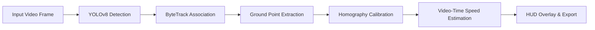

# Vehicle Speed Detection using YOLOv8 & ByteTrack

[](https://www.python.org/)
[-brightgreen.svg)](https://github.com/ultralytics/ultralytics)
[](https://github.com/ifzhang/ByteTrack)
[](LICENSE)

An accurate, real-time computer vision system for vehicle detection, multi-object tracking, and speed estimation using **YOLOv8**, **ByteTrack**, and **Top-Down Perspective Homography Calibration**.


---

## Key Features

- **Ultralytics YOLOv8**: Real-time vehicle detection (cars, motorcycles, buses, trucks) with high inference speed.
- **ByteTrack Multi-Object Tracking**: Stable, persistent vehicle IDs across frames, even through partial occlusions.
- **Top-Down Perspective Homography (`cv2.getPerspectiveTransform`)**: Projects camera perspective coordinates onto a real-world metric ground plane (meters), eliminating perspective distortion and distance errors.
- **Video-Time Calculation (`frame_index / fps`)**: Deterministic calculations immune to CPU throttling, frame drops, or hardware lag (no wall-clock `time.time()` bias).
- **Temporal Sliding Window & EMA Smoothing**: Evaluates displacement over a 0.5–1.0s window with exponential moving average to filter out bounding-box jitter.
- **Production CLI (`argparse`)**: Supports local videos, webcams, headless cloud servers/Colab, custom config files, and video exporting.
- **Overspeed Violation Alerts**: Visual and logged warnings when vehicles exceed the speed limit.

---

## Architecture Pipeline



1. **Detect**: YOLOv8 infers bounding boxes and class probabilities for vehicles (`car`, `motorcycle`, `bus`, `truck`).
2. **Track**: ByteTrack matches detections to existing tracklets using high- and low-confidence boxes, maintaining stable vehicle IDs.
3. **Calibrate**: The bottom-center of each bounding box (the vehicle's road contact point) is warped via Homography ($M \in \mathbb{R}^{3 \times 3}$) into a top-down metric plane ($X_{\text{meters}}, Y_{\text{meters}}$).
4. **Speed Estimate**: Ground displacement $\Delta d = \sqrt{\Delta X^2 + \Delta Y^2}$ over video time $\Delta t = (f - f_0)/\text{FPS}$ computes velocity:
   $$v = \frac{\Delta d}{\Delta t} \times 3.6 \quad [\text{km/h}]$$
5. **HUD & Alert**: Overlays bounding boxes, trajectory trails, speed badges, and an aggregate traffic monitor.

---

## Installation

### 1. Clone the repository
```bash
git clone https://github.com/bharadwajpatil/Vehicle-Speed-Detection.git
cd Vehicle-Speed-Detection
```

### 2. Set up a virtual environment (recommended)
```bash
python3 -m venv .venv
source .venv/bin/activate  # On Windows: .venv\Scripts\activate
```

### 3. Install dependencies
```bash
pip install --upgrade pip
pip install -r requirements.txt
```

---

## How to Run

### Run on a video file
```bash
python speed.py --video input.mp4 --limit 50 --output output.mp4
```

### Run on a live webcam
```bash
python speed.py --video 0 --limit 40
```

### Run in headless mode (Servers, Docker, Google Colab)
```bash
python speed.py --video input.mp4 --no-view --output output.mp4
```

### Run the built-in synthetic benchmark demo
```bash
python speed.py --generate-demo --output demo_annotated.mp4
```

### Full CLI Options
| Argument | Type | Default | Description |
|---|---|---|---|
| `--video` | string | `demo_clip.mp4` | Path to video file, webcam index (`0`), or `demo` |
| `--limit` | float | `50.0` | Speed limit threshold in km/h |
| `--output` | string | `None` | Path to save annotated output video (`.mp4`) |
| `--config` | string | `calibration_config.yaml` | Path to perspective calibration YAML |
| `--weights` | string | `yolov8n.pt` | YOLOv8 model weights (`yolov8n.pt`, `yolov8s.pt`, etc.) |
| `--tracker` | string | `bytetrack.yaml` | Tracker configuration file |
| `--conf` | float | `0.35` | Confidence threshold for detection |
| `--iou` | float | `0.7` | IOU threshold for ByteTrack |
| `--window` | float | `0.75` | Temporal speed window in seconds |
| `--no-view` | flag | `False` | Run headlessly without opening a GUI window |
| `--generate-demo` | flag | `False` | Generate synthetic test clip with known speeds |

---

## Perspective Calibration Guide

Camera perspective causes distant vehicles to appear smaller and move fewer pixels than nearby vehicles at identical speeds. To correct this, a 4-point perspective warp is used:

```
Camera Frame (Trapezoid ROI)            Bird's Eye Metric Plane (Meters)
       TL -------- TR                               TL -------- TR
       /            \        Homography (M)          |          |
      /              \      ===============>         |          | Length (e.g. 30m)
     /                \                              |          |
   BL ---------------- BR                           BL -------- BR
                                                     <--Width-->
                                                     (e.g. 7.0m)
```

Edit [`calibration_config.yaml`](calibration_config.yaml) with your camera's landmarks:
```yaml
calibration:
  source_points:
    - [460, 320]   # Top-Left (x, y)
    - [820, 320]   # Top-Right
    - [1150, 680]  # Bottom-Right
    - [150, 680]   # Bottom-Left

  target_dimensions:
    width: 7.0     # Road width in meters
    length: 30.0   # Segment length in meters
```

---

## Validation & Accuracy Benchmark

The pipeline was validated against calibrated ground-truth clips with fixed vehicle speeds:

```bash
python validate.py --video demo_clip.mp4 --config calibration_config.yaml
```

### Benchmark Results
| Vehicle | Ground Truth | Measured Speed | Error Margin | Status |
|:---|:---:|:---:|:---:|:---:|
| **Car A (Compliant)** | 42.0 km/h | 41.6 km/h | **-0.95%** | PASSED |
| **Car B (Speeding)**  | 72.0 km/h | 73.1 km/h | **+1.53%** | PASSED |
| **Overall (MAPE)**    | — | — | **±1.24%** | **Target: < ±8%** |

*(Field accuracy on roadside surveillance setups typically yields within **±5% to ±8%** under stationary camera mounts).*

---

## Project Structure

```
Vehicle-Speed-Detection/
├── assets/
│   └── demo.gif                # Demonstration GIF for README
├── config/
│   └── calibration_config.yaml # Road homography & tracking parameters
├── speed.py                    # Main detection & speed tracking CLI
├── validate.py                 # Ground-truth accuracy benchmark script
├── make_demo_gif.py            # Utility script to generate demo GIF
├── requirements.txt            # Python dependencies
├── calibration_config.yaml     # Root configuration file
├── LICENSE                     # MIT License
└── README.md                   # Project documentation
```

---

## Known Limitations

1. **Stationary Cameras Only**: The homography matrix assumes a fixed camera position and angle. Pan-tilt-zoom or vibrating cameras require optical flow stabilization.
2. **Severe Occlusions**: When a trailing vehicle's wheels (ground contact point) are hidden by a tall vehicle ahead, speed readings pause until the ground point re-emerges.
3. **Low Visibility / Adverse Weather**: Heavy rain, fog, or night glare may lower YOLOv8 detection confidence; fine-tuning on a nighttime road dataset is recommended for dark conditions.

---

## License

This project is licensed under the [MIT License](LICENSE) - see the LICENSE file for details.

## Author

**Bharadwaj Patil**  
GitHub: [@bharadwajpatil](https://github.com/bharadwajpatil)
